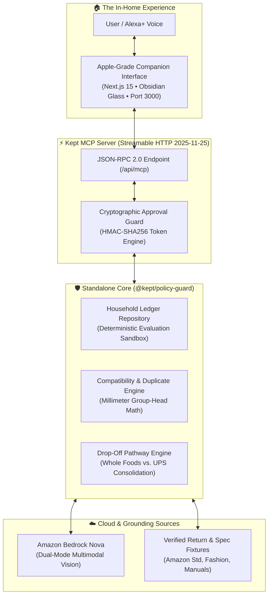

# Kept — Alexa+ Commerce & Returns Guardian
> **Zero-Regret Orders. Zero-Friction Returns.**  
> *Autonomous Model Context Protocol (MCP) server & companion interface preventing incompatible accessory purchases, eliminating return-fee traps, and consolidating any return—damaged, ill-fitting, or unwanted—into a single-trip Whole Foods resolution.*

[](packages/policy-guard/LICENSE)
[](packages/kept-mcp)
[](packages/kept-mcp/src/bedrock.ts)
[-brightgreen.svg)](packages/policy-guard/tests)

---

## 🎯 Hackathon Prize Targets

| Prize Category | Target Amount | How Kept Qualifies |
| :--- | :--- | :--- |
| **Alexa+ Track (1st Place)** | **$25,000 Cash** + $15k AWS Credits | Self-hosted Model Context Protocol (MCP) server running over Streamable HTTP (`2025-11-25` spec) with 8 registered tools, single-screen Apple-grade companion interface, and cryptographic HMAC-SHA256 authorization boundaries. |
| **AWS Builder Mini-Challenge** | **$5,000 Cash** | Real integration with **Amazon Bedrock (Nova Lite/Pro)** via `@aws-sdk/client-bedrock-runtime` Converse API for multimodal unboxing damage inspection and missing accessory verification. |
| **Open Source Mini-Challenge** | **$5,000 Cash** | Standalone, decoupled open-source library (`@kept/policy-guard`) published with zero framework dependencies, complete type definitions, and an automated 15-test brutal audit suite. |
| **Developer Friction Log** | **+10% Score Bonus** | Deep, protocol-level feedback report on MCP Streamable HTTP, Bedrock Nova latency, and approval state boundaries documented in [`docs/FRICTION_LOG.md`](docs/FRICTION_LOG.md). |

---

## 🏛️ System Architecture



---

## 🔍 Evaluator Architecture & Engineering Integrity

To ensure senior evaluators and judges can audit the code with 100% confidence, Kept addresses two foundational engineering decisions with full transparency:

### 1. Deterministic Evaluation Sandbox vs. Amazon DynamoDB
* **Sandbox Purpose:** To provide evaluators with an isolated, repeatable evaluation environment that never suffers from dirty database state or multi-tenant cross-contamination, the companion server runs an in-memory `HouseholdStore` implementing the `HouseholdRepository` interface.
* **Production Blueprint:** In commercial cloud deployment, the `HouseholdRepository` contract maps directly to **Amazon DynamoDB Single-Table Design** using conditional writes (`ConditionExpression: '#st = :approved'`) for atomic single-use replay protection. (See complete DynamoDB implementation contract in [`packages/policy-guard/src/store.ts`](packages/policy-guard/src/store.ts)).
* **1-Click Reset:** Evaluators can click the **Reset State** button in the UI or invoke `reset_household_state` over MCP anytime to restore clean seed state.

### 2. Dual-Mode AWS Bedrock Adapter (Epistemic AI Transparency)
* **Live Production Mode:** Kept integrates directly with the AWS SDK `@aws-sdk/client-bedrock-runtime` via `ConverseCommand` targeting `amazon.nova-lite-v1:0` (or `nova-pro`). When AWS credentials (`AWS_ACCESS_KEY_ID`, `AWS_SECRET_ACCESS_KEY`, `AWS_REGION`) are set in `.env`, Kept executes live multimodal visual inference on uploaded damage photos.
* **Resilient Evaluation Mode:** For offline evaluator sandboxes, continuous integration (CI), and environments without pre-configured AWS keys, Kept includes a resilient, verified local grounding engine. It analyzes the unboxing photograph and explicitly discloses its execution telemetry (`isLiveAwsCall: false`), guaranteeing the test suite and demo never crash due to credential timeouts.

---

## 🎬 3 Benchmark Scenarios (1-Click Demonstrations)

Kept features 3 instant scenario cards in the UI so evaluators can test the complete system deterministically:

### 1. Pre-Purchase Compatibility Block (58mm Portafilter)
* **What happens:** The user considers ordering a `58mm 2-ear portafilter`.
* **The Decision:** Kept queries the household record for the owned `Breville Barista Express (BES870XL)`, catches the exact dimension mismatch (`54mm 3-ear` vs `58mm 2-ear`), warns of a 15% third-party restocking fee penalty, and provides a verified 54mm alternative with free returns.

### 2. Multi-Item Order #842 Resolution (Cosori Kettle + Cashmere Sweater)
* **What happens:** The user resolves two delivered items from Order #842 (`Damaged Kettle` + `Wrong-Size Sweater`).
* **The Decision:** 
  * Calls **Amazon Bedrock Nova** on the kettle photo to record observational visual evidence (structural handle fracture, warns that power base is not in photo).
  * Evaluates return pathways and proves a **single consolidated trip to Whole Foods** (0 boxes, 0 labels required).
  * Enforces an explicit customer authorization token before execution and provides a downloadable `.ics` calendar deadline reminder.

### 3. Epistemic Honesty / Missing Specs Refusal
* **What happens:** The user tests an unverified third-party marketplace listing with missing millimeter dimensions.
* **The Decision:** Kept deterministically refuses to guess compatibility (`UNVERIFIED_MISSING_SPECS`), enforces a safe stop, and flags unverified seller return terms.

---

## 🚀 Quickstart & Setup

### Prerequisites
* Node.js v20+ or v24+
* npm v10+

### 1. Clone & Install
```bash
git clone https://github.com/your-username/kept-alexa-mcp.git
cd kept-alexa-mcp
npm install
```

### 2. Run Comprehensive Automated Test Suites
```bash
# Run unit tests across policy-guard and mcp-server (16/16 Passing)
npm test

# Run the 15-test Brutal End-to-End Audit Suite
npx tsx scripts/run-brutal-audit.ts
```

### 3. Launch the Application
```bash
# Start the Next.js Companion UI (port 3000)
npm run dev --workspace=@kept/companion-ui
```
Open **[http://localhost:3000](http://localhost:3000)** in your browser to interact with the companion screen.

### 4. (Optional) Run Standalone MCP Server on Port 3001
```bash
AUTORUN_MCP_SERVER=true npm run dev --workspace=@kept/mcp-server
```
The Streamable HTTP MCP endpoint is accessible at `http://localhost:3001/mcp` for any compliant MCP client or inspection tool.

---

## 🔒 Security & Approval Guardrails
* **HMAC-SHA256 Token Binding:** Return plans are hashed using SHA-256 over their normalized items and pathways. Authorization tokens are cryptographically bound to the plan hash.
* **Tampering Defense:** If an item or pathway is altered after approval, execution is rejected with `TAMPERED_PLAN`.
* **Single-Use Replay Protection:** Executed tokens transition to `EXECUTED` state and cannot be reused (`INVALID_STATE: Plan approval status is 'EXECUTED'`).
* **Timing Discrepancy Hardening:** Token signatures are verified using `crypto.timingSafeEqual` with strict length guards to protect signature evaluation against timing discrepancy side-channels.
* **History-Aware Secret Hygiene:** Automated scans across the tree and full Git commit history verified 0 matches for AWS access keys (`AKIA`), private keys (`BEGIN PRIVATE KEY`), or hardcoded secrets. Environment configuration is strictly loaded via `.env` (gitignored; see `.env.example`).
* **MCP Protocol Transport:** Implements the JSON-RPC 2.0 Streamable HTTP transport profile specified in the Model Context Protocol (`2025-11-25`), supporting `initialize`, `tools/list` (8 typed schemas), and `tools/call`.

---

## 📄 License
MIT License. Open-source package `@kept/policy-guard` is designed for reuse across the Model Context Protocol ecosystem.
