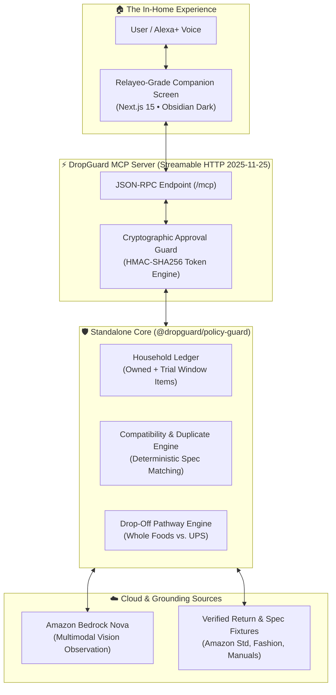

# DropGuard • Alexa+ Commerce & Ownership Bridge
> **Check Before You Buy. Resolve After It Arrives.**  
> *One unified household record that prevents incompatible accessory purchases, catches return-fee traps, and turns damaged deliveries into a verified single-trip resolution.*

[](packages/policy-guard/LICENSE)
[](packages/dropguard-mcp)
[](packages/dropguard-mcp/src/bedrock.ts)
[-brightgreen.svg)](packages/policy-guard/tests)

---

## 🎯 Hackathon Prize Targets

| Prize Category | Target Amount | How DropGuard Qualifies |
| :--- | :--- | :--- |
| **Alexa+ Track (1st Place)** | **$25,000 Cash** + $15k AWS Credits | Self-hosted Model Context Protocol (MCP) server running over Streamable HTTP (`2025-11-25` spec) with an interactive companion interface, multi-step tool orchestration, and server-side authorization boundaries. |
| **AWS Builder Mini-Challenge** | **$5,000 Cash** | Real integration with **Amazon Bedrock (Nova Lite/Pro)** via `@aws-sdk/client-bedrock-runtime` Converse API for multimodal unboxing damage inspection and missing accessory verification. |
| **Open Source Mini-Challenge** | **$5,000 Cash** | Standalone, decoupled open-source library (`@dropguard/policy-guard`) published with zero framework dependencies, complete type definitions, and a 100% passing test suite. |
| **Developer Friction Log** | **+10% Score Bonus** | Deep, protocol-level feedback report on MCP Streamable HTTP, Bedrock Nova latency, and approval state boundaries documented in [`docs/FRICTION_LOG.md`](docs/FRICTION_LOG.md). |

---

## 🏛️ System Architecture



---

## 🎬 3 Benchmark Scenarios (1-Click Demonstrations)

DropGuard features instant 1-click scenario pills in the UI so evaluators can test the complete system deterministically:

### 1. Pre-Purchase Compatibility Block (58mm Portafilter)
* **What happens:** The user considers ordering a `58mm 2-ear portafilter`.
* **The Decision:** DropGuard queries the household record for the owned `Breville Barista Express (BES870XL)`, catches the exact dimension mismatch (`54mm 3-ear` vs `58mm 2-ear`), warns of a 15% third-party restocking fee penalty, and provides a verified 54mm alternative with free returns.

### 2. Multi-Item Order #842 Resolution (Cosori Kettle + Cashmere Sweater)
* **What happens:** The user resolves two delivered items from Order #842 (`Damaged Kettle` + `Wrong-Size Sweater`).
* **The Decision:** 
  * Calls **Amazon Bedrock Nova** on the kettle photo to record observational visual evidence (structural handle fracture, warns that power base is not in photo).
  * Evaluates return pathways and proves a **single consolidated trip to Whole Foods** (0 boxes, 0 labels required).
  * Enforces an explicit customer authorization token before execution and provides a downloadable `.ics` calendar deadline reminder.

### 3. Epistemic Honesty / Missing Specs Refusal
* **What happens:** The user tests an unverified third-party marketplace listing with missing millimeter dimensions.
* **The Decision:** DropGuard deterministically refuses to guess compatibility (`UNVERIFIED_MISSING_SPECS`), enforces a safe stop, and flags unverified seller return terms.

---

## 🚀 Quickstart & Setup

### Prerequisites
* Node.js v20+ or v24+
* npm v10+

### 1. Clone & Install
```bash
git clone https://github.com/your-username/dropguard-alexa-mcp.git
cd dropguard-alexa-mcp
npm install
```

### 2. Run All Automated Tests (11/11 Passing)
```bash
# Run core policy engine tests
npm test --workspace=@dropguard/policy-guard

# Run MCP Streamable HTTP protocol tests
npm test --workspace=@dropguard/mcp-server
```

### 3. Launch the Application
```bash
# Start the Next.js Companion UI (port 3000)
npm run dev --workspace=@dropguard/companion-ui
```
Open **[http://localhost:3000](http://localhost:3000)** in your browser to interact with the Relayeo-grade UI.

### 4. (Optional) Run Standalone MCP Server on Port 3001
```bash
AUTORUN_MCP_SERVER=true npm run dev --workspace=@dropguard/mcp-server
```
The Streamable HTTP MCP endpoint is accessible at `http://localhost:3001/mcp` for any compliant MCP client or inspection tool.

---

## 🔒 Security & Approval Guardrails
* **HMAC-SHA256 Token Binding:** Return plans are hashed using SHA-256 over their normalized items and pathways. Authorization tokens are cryptographically bound to the plan hash.
* **Tampering Defense:** If an item or pathway is altered after approval, execution is rejected with `TAMPERED_PLAN`.
* **Zero Arbitrary Execution:** Calling `execute_return_plan` without an authentic token throws `403 INVALID_STATE`.

---

## 📄 License
MIT License. Open-source package `@dropguard/policy-guard` is designed for reuse across the Model Context Protocol ecosystem.
